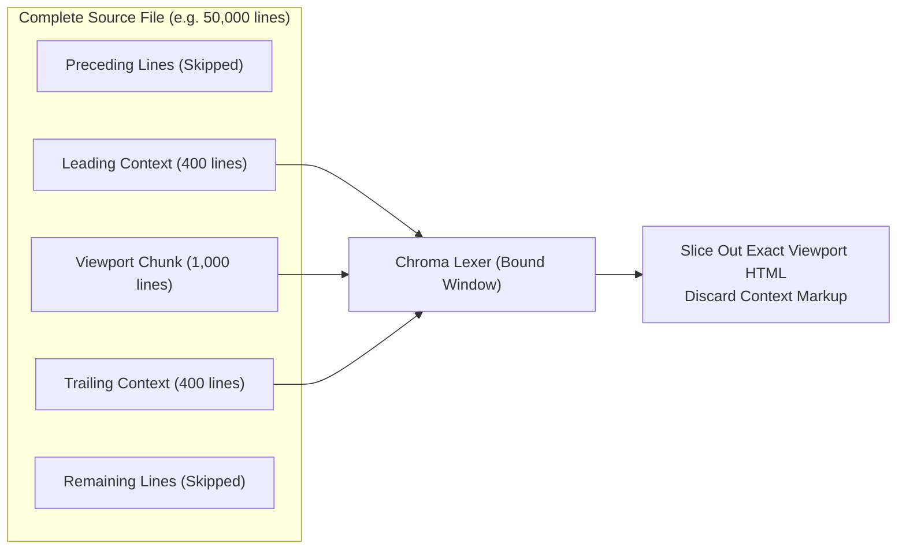
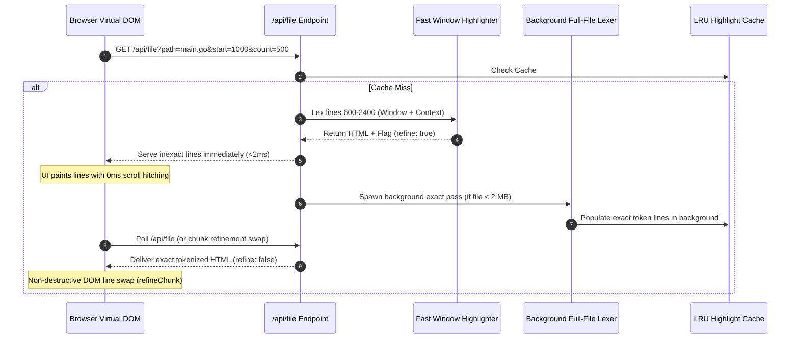

# Windowed Syntax Highlighting Engine

This document details the architecture and performance strategies of px0's windowed syntax highlighting engine ([`internal/render/render.go`](../../internal/render/render.go)).

Code folding reuses the source retained by the render document and charges lazy
fold ranges to the same cache budget. Its bounded lexical scan runs separately
after first paint and never requests another Chroma pass. See
[Code Folding Architecture](code-folding.md) for range detection and lifetime.

## 1. The Syntax Highlighting Bottleneck

px0 utilizes [Chroma](https://github.com/alecthomas/chroma) (a pure Go syntax highlighter modeled after Pygments) to tokenize ~280 programming languages without external dependencies or CGO.

However, full-AST lexical analysis is computationally intensive:

- Chroma lexers typically process source text at roughly 500 KB to 1.5 MB per second.
- Highlighting a 100,000-line file (several megabytes of code) upfront would introduce a 3-to-8 second freeze before displaying the first line.
- Naive lexing of an entire file requires holding millions of syntax token structs on the heap.

To deliver instantaneous file opening (under 5 milliseconds), px0 implements Viewport-Based Windowed Highlighting with Dual-Tier Background Refinement.

## 2. Windowed Highlighting Architecture

Rather than tokenizing the entire file, px0 tokenizes only the slice of lines needed by the user's current scroll viewport, padded with leading and trailing context:



### Highlighting Parameters

- `hlChunk = 1000`: Number of active lines tokenized for the current request.
- `hlContext = 400`: Number of preceding lines fed into the lexer.
  - Leading Context Purpose: Resets the lexer into the correct multi-line state (e.g., inside a multi-line docstring, backtick template literal, or block comment).
  - Trailing Context Purpose: Ensures open tokens are properly closed without trailing syntax anomalies.
- `hlWindowBytes = 512 KB`: Maximum byte size for any tokenization window.

When constructing a `Doc` (`newDoc`), line byte offsets (`lineOff`) and maximum visual column width are computed in a single `strings.IndexByte` scan over the source string without splitting the file into a `[]string` slice. If filename matching (`lexers.Match`) does not identify the language, content analysis (`lexers.Analyse`) is capped to the first 4 KB (`4096` bytes).

### Byte-Cap Protection (`hlWindowBytes`)

In minified JavaScript or massive one-line JSON documents, 1,000 lines could equal 20+ megabytes of text. If a window slice exceeds `512 KB`, context lines are automatically dropped to prevent CPU hangs.

## 3. Dual-Tier Refinement Architecture

While 400 lines of context correctly identifies >99.5% of syntax states, extreme cases exist where a raw string literal or comment block opens 2,000 lines earlier.

px0 handles this with a Dual-Tier Processing Strategy:



1. Tier 1 (Instant Viewport Pass): Evaluates the bounded window (`start - hlContext` to `start + count + hlContext`). Slices out and returns the target lines in 1-2 ms. If the entire file fits within the first chunk (`Total <= hlChunk` and within `hlWindowBytes`), `chunk(0)` marks the document exact (`d.full = true`) immediately so no background pass is needed. Otherwise, if the window contains potential multi-line ambiguities, the payload includes `refine: true`.
1. Tier 2 (Background Exact Pass): For multi-chunk files under `bgLimit = 2 MB`, a background goroutine performs an exact full-file tokenization pass. The exact result is stored in the LRU cache. The frontend's `refineChunk()` updates the rendered rows in-place without disturbing the user's scroll position or selection.

## 4. Short-Class CSS Tokenization

Chroma's default HTML formatter outputs lengthy inline CSS or verbose class names (e.g. `<span class="chroma-keyword-declaration">func</span>`), which bloats the DOM and increases network payload size.

px0 maps token types to minimal 1-to-2 character CSS classes:

| Class  | Chroma Token Type    | Semantic Role                                 |
| ------ | -------------------- | --------------------------------------------- |
| `.k`   | `Keyword`            | Language keywords (`func`, `return`, `class`) |
| `.nf`  | `NameFunction`       | Function declarations and calls               |
| `.s`   | `LiteralString`      | String literals                               |
| `.m`   | `LiteralNumber`      | Numeric constants                             |
| `.c`   | `Comment`            | Single and multi-line comments                |
| `.kd`  | `KeywordDeclaration` | Type declarations                             |
| `.kt`  | `KeywordType`        | Primitive types (`int`, `string`, `bool`)     |
| `.err` | `Error`              | Syntax errors                                 |

This keeps network payloads minimal and guarantees that CSS stylesheets define colors cleanly through CSS custom properties (`--k`, `--nf`, `--s`, `--c`). During formatting, token text is HTML-escaped directly into the line's `strings.Builder` (`writeHTMLEscaped`) to avoid intermediate string allocations per token.

## 5. Byte-Budgeted LRU Memory Cache & Idle Scavenging

Generated HTML fragments are cached in memory using a Least Recently Used (LRU) eviction policy backed by Go's `container/list`.

```go
const (
	cacheBudget     = 64 << 20 // 64 MB active memory budget
	idleCacheBudget = 8 << 20  // 8 MB idle budget after 15s scavenger pass
)
```

- Every cached line entry tracks its raw string byte footprint.
- When total cached line data exceeds `cacheBudget`, oldest entries are evicted from the tail of the LRU list until memory drops below the threshold.
- When the server has been idle for 15 seconds, `Server.scavenge()` invokes `render.Scavenge()`, trimming the cache down to `idleCacheBudget` (8 MB) before calling `debug.FreeOSMemory()`.
- Switching between tabs and scrolling backward reuses cached HTML strings instantly without hitting Chroma.
